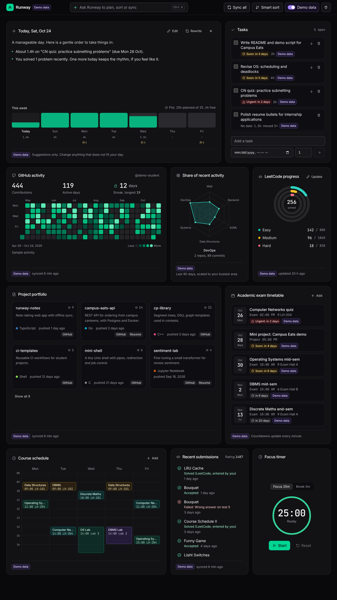

# Runway

A calm, real-time dashboard for computer science students. It connects **GitHub**, **Codeforces**, a **resume** and a **timetable**, and includes an agent that plans your week, sorts what matters, and syncs everything in one click. Every AI feature has a local fallback, so the app runs fully without an API key.

> The product name lives in one constant: `shared/src/constants.ts` → `APP_NAME`.



## Setup

Requires Node.js 20 or newer.

```bash
git clone https://github.com/Technomaniac143/TECH-CONF-26.git
cd TECH-CONF-26
npm install
npm run dev
```

Open http://127.0.0.1:5173. The API runs on http://127.0.0.1:8787 (loopback only; there are no accounts).

An `.env` file is optional. Copy `.env.example` to `.env` to turn on AI:

| Variable | Default | What it does |
| --- | --- | --- |
| `ANTHROPIC_API_KEY` | empty | Enables AI resume extraction, project ranking, the AI agent and the AI-written briefing. Stays on the server. |
| `ANTHROPIC_MODEL` | `claude-sonnet-5-5` | Model used for all AI calls. |
| `PORT` | `8787` | API port. |
| `SYNC_INTERVAL_MINUTES` | `15` | Background refresh of GitHub and Codeforces (also editable in Settings). |
| `RUNWAY_DATA_DIR` | `server/data` | Where the SQLite database (or JSON fallback) lives. |

Production: `npm run build && npm start` serves the app and API together on http://127.0.0.1:8787.

## Scripts

| Command | What it does |
| --- | --- |
| `npm run dev` | Server (tsx watch) and web (Vite) together |
| `npm test` | Vitest: planner, sorter, radar, streak, parsers, adapters with mocked fetch, sync, agent, API |
| `npm run typecheck` | TypeScript in all workspaces |
| `npm run lint` | ESLint |
| `npm run build` | Production build |

## Two-minute demo

1. **Demo data** (header switch). Every card fills with clearly badged sample data, dated relative to today. Your real data is kept separately.
2. **Sync all**. Watch per-source chips stream progress over Server-Sent Events, then a summary toast such as "GitHub +0 events, Codeforces +1 submission, Resume unchanged". A new submission appears in Recent submissions without a reload.
3. **Smart sort**. The preview shows what moves and why across tasks (earliest deadline first, with slack and "moved 3 times" flags), projects (ranked for your target role) and skills (by evidence). Apply animates the reorder; open Smart sort again to undo.
4. **Ctrl/⌘ K** and pick "I have an exam in 6 days and a project due in 4, plan my week". The agent reads your dates and tasks, asks you to approve each new date and prep task, then lays out the week.
5. Try "Which projects should I put first for a backend internship?" and "What is missing from my resume for a data role?".
6. Turn Demo data off, open **Connections**, add a GitHub username, a Codeforces handle, upload a resume and add an exam date. Press **Sync all**.

## How it works

- `shared/` – zod schemas and pure logic: week planner, slack check, sorter, radar, streak, verdict words, heuristic resume parser, demo data.
- `server/` – Hono API, SQLite via better-sqlite3 behind a small repository interface (falls back to a JSON file if the native module will not load), SSE at `/api/events`, node-cron scheduler, source adapters, agent.
- `web/` – Vite, React, Tailwind. No animation library: CSS transforms, IntersectionObserver for ring and heatmap reveals, and a small FLIP helper for reorders. Respects `prefers-reduced-motion`.

### Sources

- **GitHub**: official REST API with ETag / If-None-Match caching and rate-limit handling. With an optional token, the contribution calendar comes from GraphQL; without one, the heatmap is built from public events and labelled as such (GitHub keeps about 90 days).
- **Codeforces**: official API (`user.info`, `user.rating`, `user.status`) through a queue that allows one request every two seconds.
- **LeetCode**: manual entry only. LeetCode has no public API and its terms do not allow scraping.
- **Resume**: PDF, DOCX, TXT or Markdown. Re-parsed only when the file's SHA-256 changes.
- **Timetable**: manual classes and dates, `.ics` file import and an optional `.ics` subscription link.

### Honesty rules

No fabricated numbers: real mode only shows synced or user-entered data, with empty states otherwise. The radar is "Share of recent activity" (normalized to your own busiest area, with evidence counts), not a skill score. Streaks come only from verified calendar data and are hidden when the data cannot support them. Countdowns come only from dates you enter and update once a minute. Every record shows where it came from and when it was last synced; data older than a day is marked stale.

### AI and privacy

The first time an AI feature runs, a notice explains that resume text and activity summaries go to the Anthropic API. **Local only** in Settings disables every AI call; the server enforces this too. Resume, repository and commit text are passed as tagged, untrusted data. Agent changes (`create_task`, `update_task`, `reorder`, `add_deadline`, `set_target_role`, `run_sync`) never run without your approval; the agent is limited to 8 tool calls per request. Tool calls are logged by name and status only.
